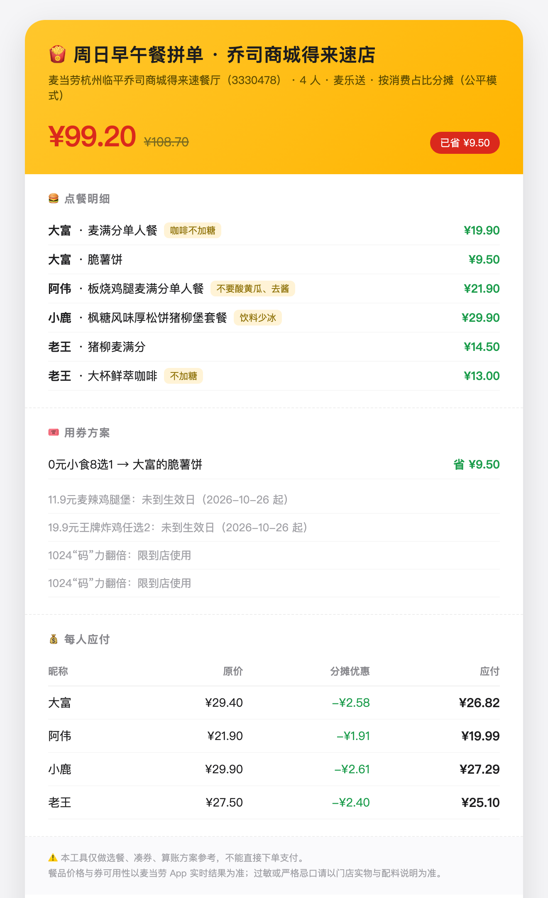
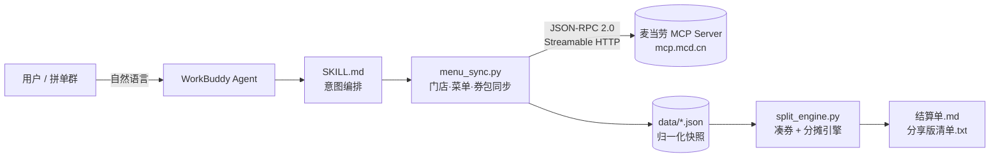
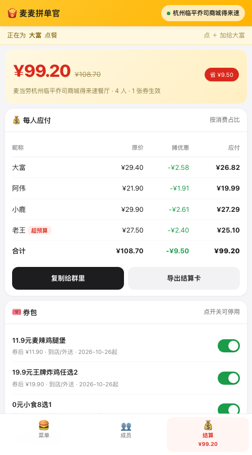
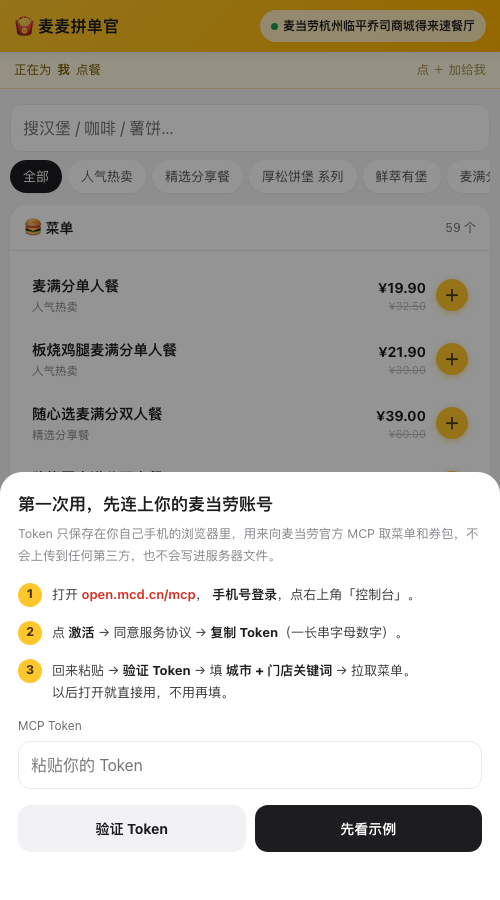
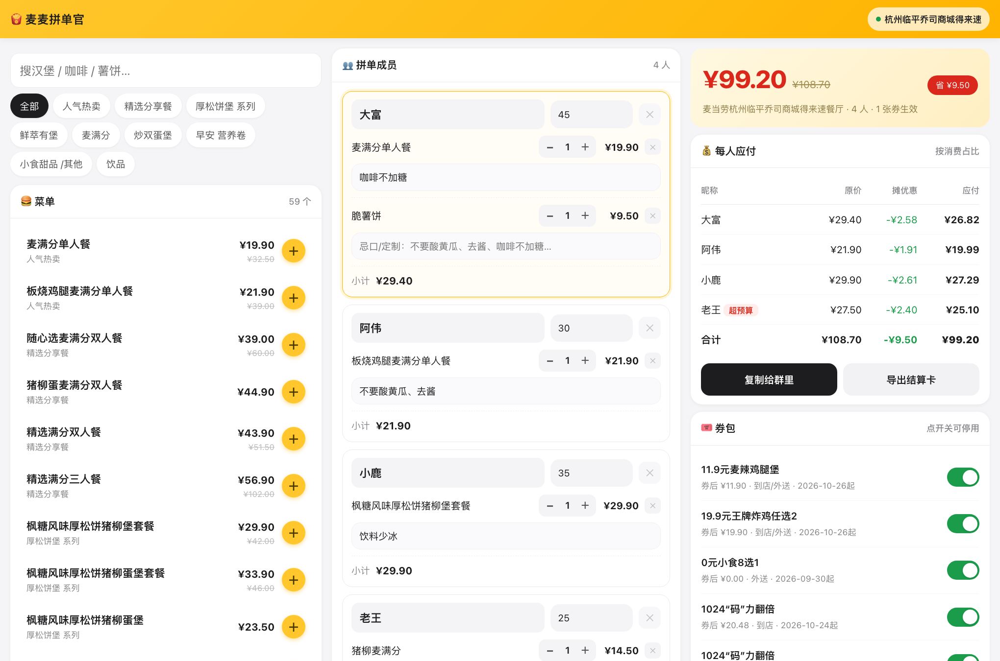

# 🍟 麦麦拼单官 · McGroupSplit

> 多人拼单点麦当劳，把「谁点了什么、哪张券该用、每人转多少钱」一次算清。
> 基于**麦当劳 MCP Server** 真实数据，跑在 **WorkBuddy** 里的拼单凑券 + AA 分摊引擎。

<p align="left">
  
  
  
  
  
</p>

如果这个项目帮你少算错一次账、多吃上一张券，**点个 Star ⭐ 就是最好的支持**。

---

## 👉 手机直接打开就能用（不用装任何东西）

<p align="center">
  
  <br>
  <b>扫码</b> 或直接打开 <a href="https://mcd-split-buddy.app.workbuddy.host/?sharecode=WSERXL34UO">mcd-split-buddy.app.workbuddy.host</a>
</p>

第一次打开会引导你贴自己的 MCP Token（三步，30 秒），之后这台手机就记住了，站在柜台前点菜、边走边算。
iPhone 用 Safari 打开后「分享 → 添加到主屏幕」，它就是个 App。

> 数据不出你的手机：菜单和券包同步后只存在本机浏览器里，服务端只做转发，不落盘、不共享。

---

## 😩 为什么需要它

办公室里点麦当劳，永远是这三步灾难现场：

1. **接龙混乱**——群里 6 个人接龙，谁要套餐谁要单品、谁不要酸黄瓜，最后没人说得清；
2. **券用不明白**——券包里有 5 张券，到底哪张能用、能用在哪份餐上、今天这个点能不能用，全靠猜；
3. **AA 算账吵架**——8 折优惠算谁的？发起人说「我付的款」，其他人说「那就 AA 啊」，最后差个几毛钱谁也不服。

市面上的「点餐助手」都在解决「推荐吃什么」，可这几个真正会让人吵起来的环节，一个都没碰。

**麦麦拼单官只干这三件事，而且干到底。**

---

## ✨ 核心能力

| # | 能力 | 说明 |
|:--:|---|---|
| 1 | **券可用性校验**（灵魂功能） | 逐张校验生效日期 / 星期几 / 可用时段 / 渠道（到店 or 外送）/ 剩余名额。真实场景里 5 张券有 4 张当场被判定不可用——**这才是省的开始，而不是把券全列一遍** |
| 2 | **凑券最优分配** | 把每张可用券分配给「最省钱且合规」的那份餐品，一张券只吃一份，贪心求最大节省 |
| 3 | **三种分摊模式** | 按消费占比（默认）/ 优惠全归发起者 / 平均分摊，一键切换 |
| 4 | **尾差可核对** | 每人金额四舍五入后，差额全部落到发起人身上，**保证每人实付之和 == 整单实付**，一分不差 |
| 5 | **忌口清单** | 把「不要酸黄瓜 / 去酱 / 咖啡不加糖」汇总成一份配料修改清单，方便下单时逐条勾 |
| 6 | **预算校验** | 每人设预算上限，谁超了直接标红提醒 |
| 7 | **分享版清单** | 生成一段可直接转发微信群的紧凑文本，@全员核对 |
| 8 | **结算卡片** | `--html` 一键生成麦门配色结算卡，手机截图就能发群/发小红书 |

<p align="center">
  
</p>

---

## 📸 效果预览（真实数据跑出来的）

4 人拼单、麦乐送、真实门店菜单与真实券包，一条命令输出：

```
## 💰 费用结算表

| 昵称 | 原价 | 分摊优惠 | 实付应付 | 预算 | 校验 |
|---|---:|---:|---:|---:|---|
| 大富 | ¥29.40 | -¥2.58 | **¥26.82** | ¥45.00 | ✅ |
| 阿伟 | ¥21.90 | -¥1.91 | **¥19.99** | ¥30.00 | ✅ |
| 小鹿 | ¥29.90 | -¥2.61 | **¥27.29** | ¥35.00 | ✅ |
| 老王 | ¥27.50 | -¥2.40 | **¥25.10** | ¥25.00 | ⚠️ 超预算 |
| **合计** | **¥108.70** | **-¥9.50** | **¥99.20** | | |
```

同一单里那 4 张没吃上的券，引擎会明明白白告诉你原因：

```
❌ 11.9元麦辣鸡腿堡      未到生效日（2026-10-26 起）
❌ 19.9元王牌炸鸡任选2    未到生效日（2026-10-26 起）
✅ 0元小食8选1           可用
❌ 1024“码”力翻倍        限到店使用
❌ 1024“码”力翻倍        限到店使用
```

> 这不是编的示例。券的生效日期、星期限制、时段、渠道，都是从麦当劳 MCP 的 `query-my-coupons` 实拉下来后解析出来的。
> 完整输出见 [`examples/demo_settlement.md`](examples/demo_settlement.md)，分享版见 [`examples/demo_share.txt`](examples/demo_share.txt)。

### 转发版（自动生成，可直接粘到群里）

```
【麦当劳拼单结算】麦当劳杭州临平乔司商城得来速餐厅（3330478） · 4人 · 麦乐送
原价 ¥108.70 - 优惠 ¥9.50 = 实付 ¥99.20
分摊方式：按消费占比分摊（公平模式）
———
大富：应付 ¥26.82（原价 ¥29.40，摊 -¥2.58）
阿伟：应付 ¥19.99（原价 ¥21.90，摊 -¥1.91）
小鹿：应付 ¥27.29（原价 ¥29.90，摊 -¥2.61）
老王：应付 ¥25.10（原价 ¥27.50，摊 -¥2.40）
———
用券：0元小食8选1(省¥9.50)
改配料：阿伟的板烧鸡腿麦满分单人餐：不要酸黄瓜、去酱；……
```

---

## 🏗️ 架构



设计上刻意做了一件事：**把「取数」和「算账」拆开**。
菜单和券会变、会过期，但分摊算法是纯函数——给它一份快照，它必须给出一个可复核的结果。所以引擎可以离线跑、可以写单测、可以在没有 Token 的情况下被别人验证。

---

## 📱 图形版：手机上点一点就拼单（推荐）

拼单这事儿都是**站在柜台前、手机在手**发生的。所以这版是**手机优先**做的：底部三个 Tab（菜单 / 成员 / 结算），点菜即出账，走到哪点到哪。

<p align="center">
  
  
</p>

```bash
python3 web/server.py          # 电脑打开 http://127.0.0.1:8765
```

想用手机开，两种方式：
1. **直接扫上面的码用线上版**（已经部署好，推荐）；
2. **自己开一份**：`python3 web/server.py`，手机连同一 Wi-Fi 访问 `http://<电脑内网IP>:8765`（服务已监听 0.0.0.0）；
3. 想完全自己掌控，把 `web/` 这套服务丢到任意支持 Python 的托管上即可（单端口、零第三方依赖、只监听 `$PORT`）。

### 第一次用：三步连上你自己的麦当劳账号

不像别的工具要你改配置文件，这里直接**手把手引导**：

| 步骤 | 页面里怎么走 |
|---|---|
| 1 | 点「打开 open.mcd.cn/mcp」→ 手机号登录 → 控制台 |
| 2 | 点「激活」→ 同意协议 → 复制 Token |
| 3 | 回来粘贴 → 点「验证 Token」（当场告诉你券包有几张）→ 填城市 + 门店关键词 → 拉菜单 |

- Token 只存在**你自己手机的浏览器 localStorage** 里，随每次请求发给你自己部署的那台服务器转发给麦当劳，**不写入任何文件、不落库、不上报第三方**；
- 验证失败会直说原因（`Token 无效或已过期`），不会让你瞎猜；
- 换手机 / 清了浏览器数据才需要重填一次；日常打开直接就是上次那家店的菜单。

> ⚠️ 公开部署时注意：菜单快照存在服务端，多人访问会共用同一份门店快照（只有门店名、菜品、价格，没有任何个人信息）；Token 不落盘，所以别人用不了你的账号。

### 能做什么

| 操作 | 效果 |
|---|---|
| 点菜单上的 ＋ | 加到「正在为 XX 点餐」的那个人名下，顶栏一直提示当前是谁 |
| 改昵称、填预算 | 超预算当场标红 |
| 填「忌口/定制」 | 自动进最终的配料修改清单 |
| 拖时间选择器 | 券能不能用会跟着变（这就是券时段校验） |
| 券包开关 | 手动停用某张券，账立刻重算 |
| 切分摊模式 / 发起者 | 三种算法实时对比，谁也不会觉得被坑 |
| 复制给群里 / 导出结算卡 | 一段推文，或一张能截图的卡片 |
| 断点续填 | 成员和餐品自动存在本地，关了浏览器再打开还在 |

桌面端会自动展开成三栏（菜单 / 成员 / 实时结算），一份代码两种布局：

<p align="center">
  
</p>

---

## 🚀 快速开始（命令行版）

### 第一步：拿 MCP Token

去 <https://open.mcd.cn/mcp> 手机号登录 → 控制台 → 激活 → 复制 Token。

### 第二步：跑起来（不需要装任何依赖）

```bash
git clone https://github.com/<your-name>/mcd-group-split.git
cd mcd-group-split

export MCD_MCP_TOKEN='你的Token'          # 只走环境变量，绝不落盘

# 同步你常去门店的菜单 + 券包
python3 scripts/menu_sync.py --city 杭州市 --keyword 临平 --channel delivery

# 算账（用仓库自带示例，60 秒看到效果）
python3 scripts/split_engine.py examples/order_demo.json          # 结算单
python3 scripts/split_engine.py examples/order_demo.json --check  # 只看券能不能用
python3 scripts/split_engine.py examples/order_demo.json --html   # + 可截图的结算卡片
```

输出写在 `out/结算单.md`、`out/分享版清单.txt`、`out/结算单.html`。

### 第三步：改成本次拼单

复制 `examples/order_demo.json`，改成你的名单：

```json
{
  "storeName": "麦当劳杭州临平乔司商城得来速餐厅（3330478）",
  "channel": "delivery",
  "mode": "proportional",
  "initiator": "大富",
  "now": "2026-10-25 10:40",
  "couponsFile": "data/coupons.json",
  "members": [
    {"nick": "大富", "budget": 45, "items": [
      {"code": "9900013812", "name": "麦满分单人餐", "price": 19.9, "qty": 1, "custom": "咖啡不加糖"}
    ]}
  ]
}
```

`now` 一定要写真实下单时间——**券的时段校验全靠它**，写错了就会算出「本来用不了的券」。

### 在 WorkBuddy 里用（推荐）

把 `mcp-config.example.json` 里的 `YOUR_MCP_TOKEN` 换成真实 Token，贴进
WorkBuddy → 连接器 → 自定义连接器 → 配置 MCP，启用后直接说话：

> 「我们 4 个人拼单，门店乔司商城得来速，我发券包截图，帮我凑券算账」

---

## 🧮 三种分摊模式

假设整单原价 ¥100，优惠 ¥10，A 消费 ¥80、B 消费 ¥20。

| 模式 | 规则 | A 实付 | B 实付 | 适合谁 |
|---|---|---:|---:|---|
| `proportional`（默认） | 优惠按各自消费占比分 | 80 - 8 = **¥72** | 20 - 2 = **¥18** | 大部分场景，最不容易吵架 |
| `initiator` | 优惠全归发起者 | **¥80** | **¥20** | 券是发起者自己账户的，别人不好占便宜 |
| `equal` | 优惠人头平均分 | 80 - 5 = **¥75** | 20 - 5 = **¥15** | 大家点得差不多、图省事 |

**尾差怎么处理？** 分摊金额四舍五入到分之后，和「实际优惠总额」必然差几分钱。引擎把这笔残差整笔记到发起者名下，因此：

```
Σ(每人实付) ≡ 整单实付
```

这条恒等式在 `split_engine.allocate()` 里是硬保证，不是靠运气。

---

## 🔌 用到了哪些麦当劳 MCP 能力

| Tool | 用在哪 | 拿什么 |
|---|---|---|
| `now-time-info` | 时间基准 | 服务器时间，用于券时段判定 |
| `query-nearby-stores` | 找门店 | storeCode、营业时间 |
| `delivery-query-addresses` / `delivery-query-stores` | 麦乐送场景 | 配送地址、storeCode → beCode 映射 |
| `query-meals` | 菜单与实时价 | 餐品编码、现价、原价、促销说明 |
| `query-my-coupons` | 券包（核心） | 券面值、生效日期、星期、时段、渠道、剩余名额 |
| `available-coupons` | 麦麦省 | 还有哪些券可以领 |
| `query-store-coupons` | 门店级券 | 该门店额外叠加券 |

详细调用链路、参数、错误码与业务价值见 [`MCP_INTEGRATION.md`](MCP_INTEGRATION.md)。

---

## 🧪 实测记录（2026-10-25 真实数据）

| 观察 | 事实 | 对拼单的影响 |
|---|---|---|
| 早餐时段菜单 | 09:00 拉取只有 59 个早餐类餐品（麦满分 / 松饼堡 / 营养卷） | 想吃麦辣鸡腿堡得等 10:30 换菜单，**早期算账等于白算** |
| 券时段限制 | 「11.9元麦辣鸡腿堡」「19.9元王牌炸鸡任选2」均限 **周一至周五 10:30 后** | 周日拼单这两张券全部作废 —— 这是人肉算账最容易踩的坑 |
| 渠道限制 | 「0元小食8选1」仅外送；「1024"码"力翻倍」仅到店 | 同一份餐品，选到店还是外送，优惠差一截 |
| 门店券 | `query-store-coupons` 对该门店返回空数组 | 该店无额外门店券，别对「门店券」抱期待 |
| 券名额 | `totalAvailableCount` = 1 | 券是一次性的，**同一天第二单就没了** |

---

## ⚠️ 已知限制（诚实说在前面）

- **券的适用商品明细**：`query-my-coupons` 不返回「这张券能用在哪几个商品上」的完整清单，本项目用标题关键词 + 餐品分类做**粗匹配**，也可以在下单 JSON 里用 `scopeKeywords` 手动指定，避免误判。
- **不能下单**：本项目只做方案，不调用 `create-order`，也不碰支付。
- **价格以 App 为准**：MCP 返回的现价可能随账号权益（早餐卡、随单购）浮动，结算前请以 App 购物车为准。
- **只覆盖到店自取 / 麦乐送**：团餐（企业团餐 beType=6）暂未接入。

---

## 📁 目录结构

```
mcd-group-split/
├── SKILL.md                      # WorkBuddy Skill 入口（意图编排）
├── README.md
├── CONTEST_DECLARATION.md        # 官方参赛声明（内容未做任何修改）
├── MCP_INTEGRATION.md            # MCP 接入说明：Server / Tool / 调用流程 / 业务价值
├── mcp-config.example.json       # 脱敏配置示例（仅环境变量占位符）
├── workbuddy.md                  # WorkBuddy 开发对话上下文（专项奖励用）
├── scripts/
│   ├── mcd_client.py             # 麦当劳 MCP 最小客户端（JSON-RPC，零依赖）
│   ├── menu_sync.py              # 门店 / 菜单 / 券包 → data/*.json
│   └── split_engine.py           # 凑券 + 分摊引擎（核心算法）
├── web/
│   ├── server.py                 # 图形版本地服务（标准库 http.server）
│   ├── index.html                # 单页界面：手机优先，桌面自动三栏
│   ├── manifest.json             # 可「添加到主屏幕」当 App 用
│   └── icon-*.png                # 应用图标
├── data/
│   └── menu.json                 # 真实菜单快照（公开价格，无敏感信息）
├── examples/
│   ├── order_demo.json           # 4 人拼单示例
│   ├── coupons.example.json      # 脱敏券包
│   ├── demo_settlement.md        # 实际输出
│   ├── demo_share.txt            # 转发版输出
│   └── demo_card.html            # 结算卡片（截图分享用）
├── docs/
│   └── preview.png               # README 预览图
└── out/                          # 运行时产物（.gitignore）
```

---

## 🔐 安全与合规

- Token **只从环境变量 `MCD_MCP_TOKEN` 读取**，代码与配置文件中不含任何真实凭证；
- 仓库内的券包示例已脱敏（`DEMO_COUPON_*` / `DEMO_CODE_*`），真实券码、券 ID、地址 ID 均不入库；
- 不存储他人个人信息，不采集用户数据，不做任何绕过风控的自动化；
- 本项目为参赛作品，由作者独立开发，**非麦当劳官方产品**；餐品信息、价格与供应状态以麦当劳官方渠道实时结果为准。

---

## 🏁 参赛信息

- 赛事：**麦当劳程序员创意开发大赛**（2026.10.09 – 2026.10.25 23:59）
- 参赛项目：麦麦拼单官 · McGroupSplit
- 开发工具：腾讯 **WorkBuddy**（开发对话上下文已导出至 [`workbuddy.md`](workbuddy.md)）
- 实际使用的 MCP 能力：见上方能力表，全部为真实调用

---

## ⭐ Star 支持

如果你也在群里接过龙、也为几毛钱 AA 扯过皮，这个项目就是为你写的。

**Star 一下，让更多被拼单算账折磨过的人看到它。**

> ⚠️ 本工具仅做选餐、凑券、算账的**方案参考，不能直接下单支付**。涉及过敏或严格忌口，请以门店实物与配料说明为准。
